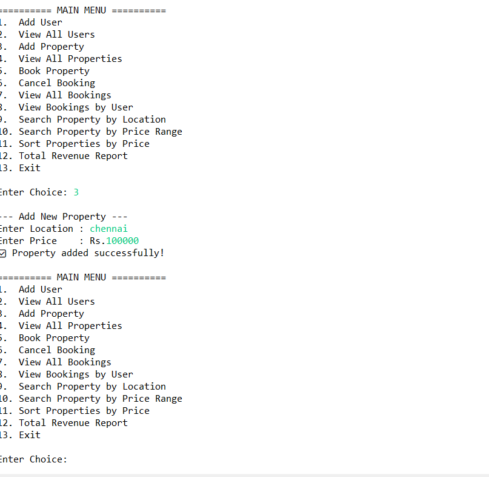
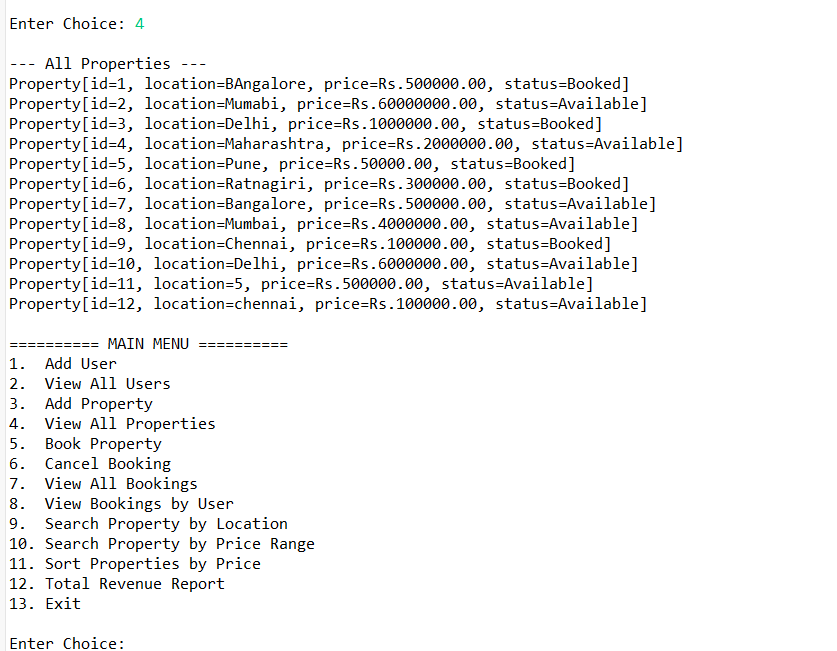
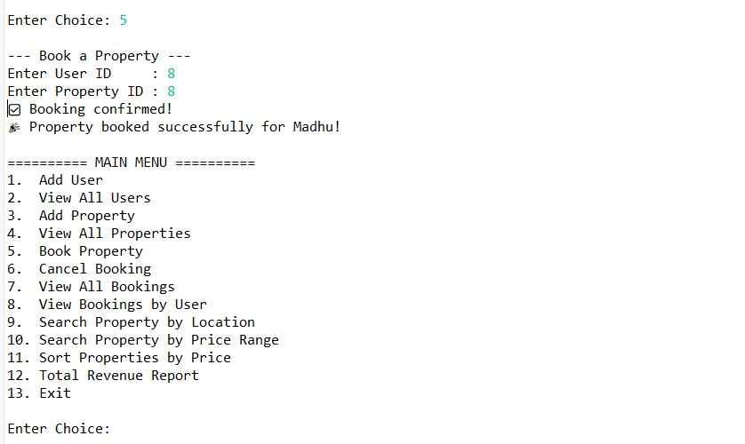
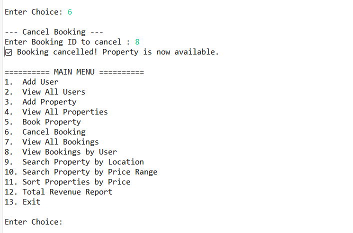
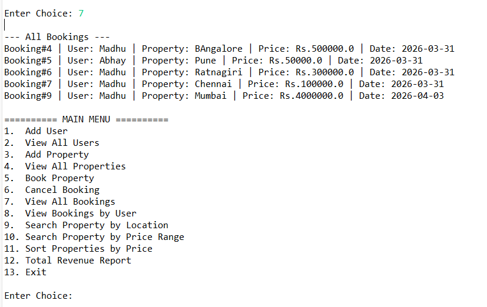
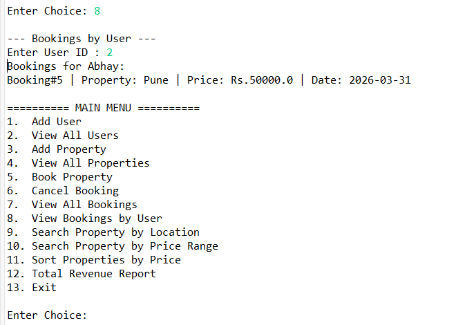
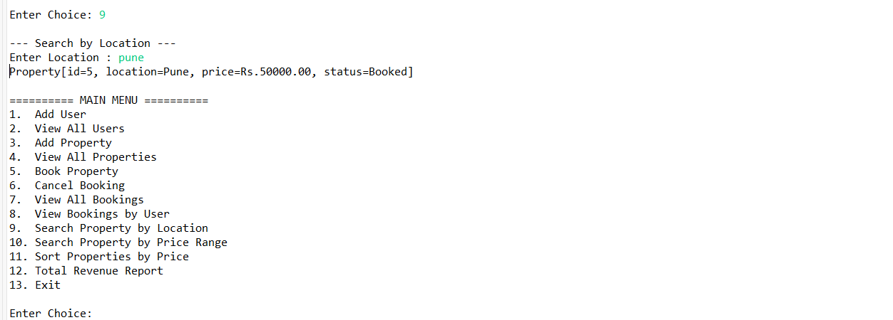
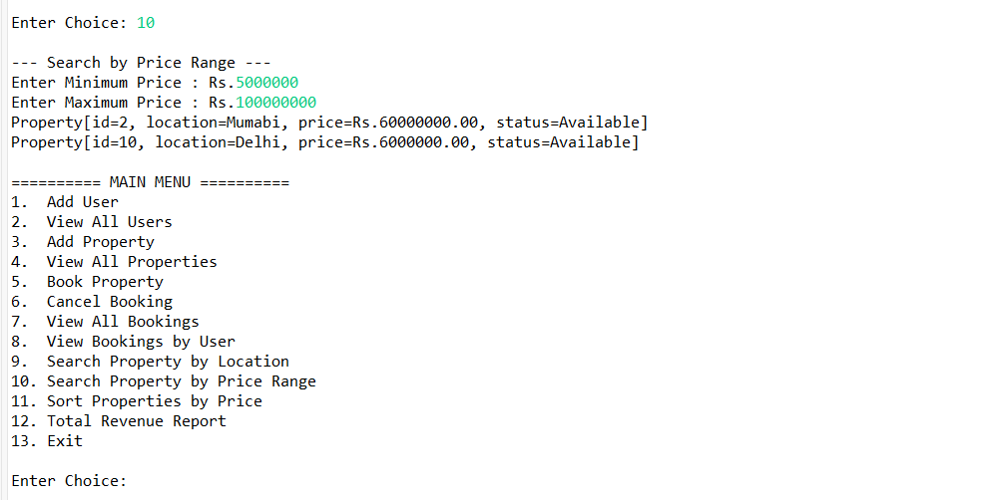
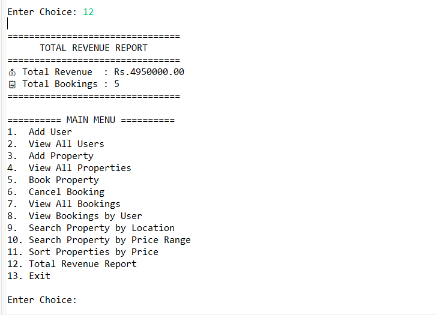
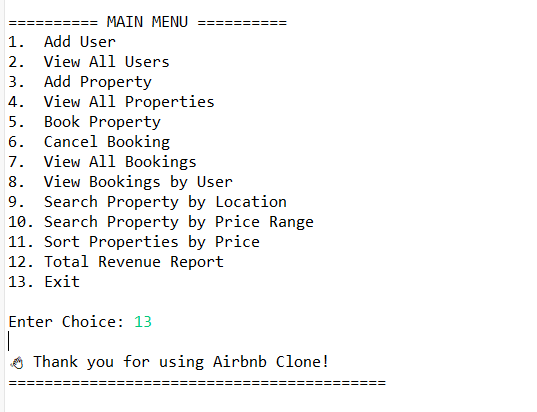

# 🏠 Airbnb Clone: Property Booking System

A menu-driven Java console application for managing users, properties and bookings, built with **Java 17, JDBC and MySQL** (hand-written SQL, no ORM).

## 🔧 Tech Stack

- Java 17
- JDBC with hand-written SQL (no ORM)
- MySQL
- Git

## 💡 Features

- Add and view users, with validation for empty names and invalid emails
- Add and view properties, with price validation
- Book a property: the app checks that the user and property exist and that the property is available
- Cancel a booking, which makes the property available again
- View all bookings, or the bookings of one user
- Search properties by location (case-insensitive) and by price range
- Sort properties by price
- Revenue report using a SQL JOIN with `SUM` and `COUNT`
- Input validation with clear error messages for invalid numbers, IDs and ranges

## 📐 Structure

```
src/com/airbnb/
├── main/         → Main.java (menu and user input)
├── model/        → User, Property
├── repository/   → UserRepository, PropertyRepository, BookingRepository (all JDBC and SQL)
└── util/         → DBConnection (MySQL connection)
database/         → SQL schema
```

## 🚀 How to Run

**Prerequisites:** Java 17, MySQL, the MySQL JDBC driver

1. Clone the repository:
   ```
   git clone https://github.com/Madhumitha-divate/airbnb-clone-java.git
   cd airbnb-clone-java
   ```
2. Create a MySQL database and run the SQL file from the `database/` folder to create the tables.
3. Set your MySQL URL, username and password in `DBConnection.java` (`com.airbnb.util`).
4. Run `com.airbnb.main.Main` from your IDE. The menu appears in the console.

## 📸 Screenshots

| | | |
|---|---|---|
|  |  |  |
|  |  |  |
|  |  |  |
|  |  | |

## ⚠️ Known Limitations

- Booking is two separate database steps (save the booking, then mark the property unavailable) with no transaction, so two simultaneous bookings could both succeed.
- Bookings have no check-in or check-out dates.
- There is no login or authentication.

## 🔮 Future Improvements

- Wrap booking in a JDBC transaction with a conditional update, to prevent double booking safely
- Add check-in and check-out dates with overlap checks
- Add JUnit tests for the booking and cancellation logic
- Move to Spring Boot with REST APIs

## 👩‍💻 Author

**Madhumitha Divate**

- LinkedIn: https://www.linkedin.com/in/madhumitha-divate/
- GitHub: https://github.com/Madhumitha-divate
